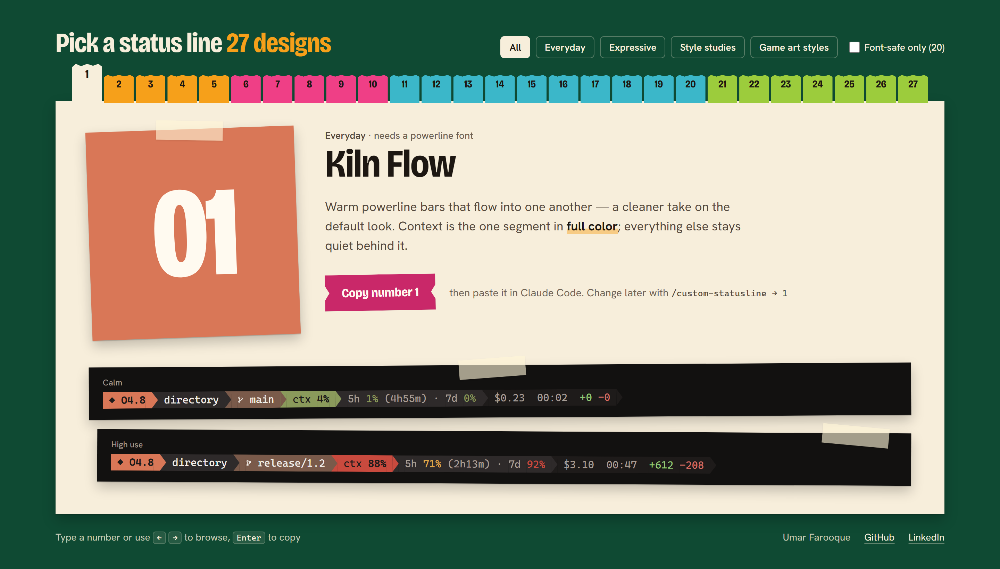
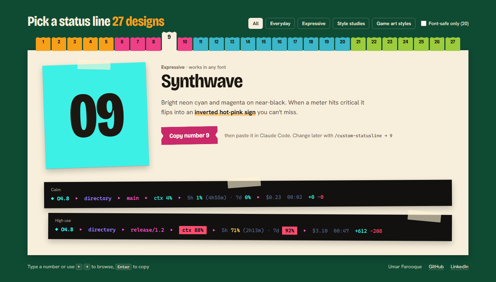
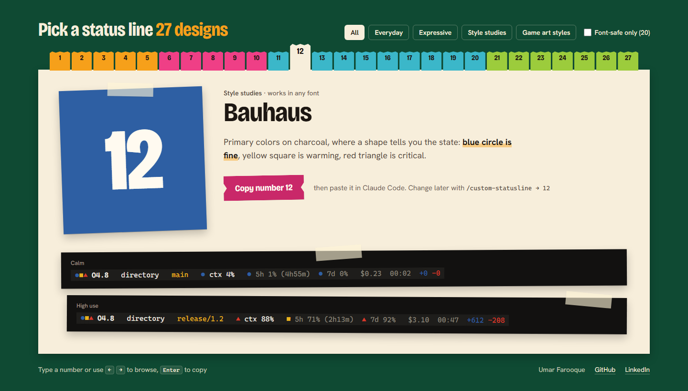
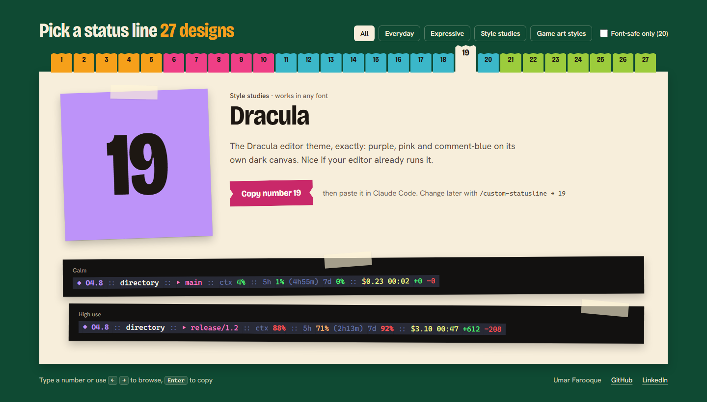
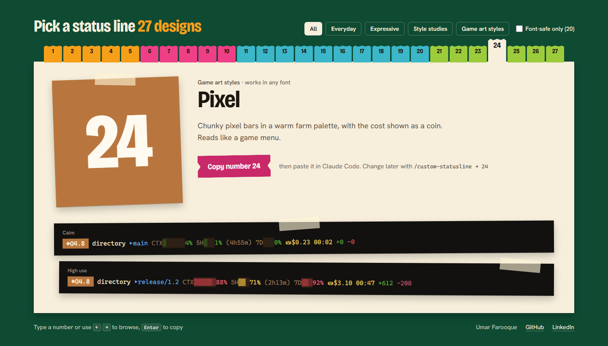
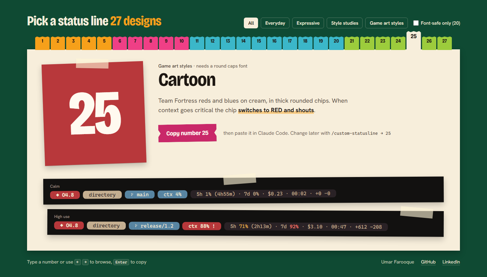
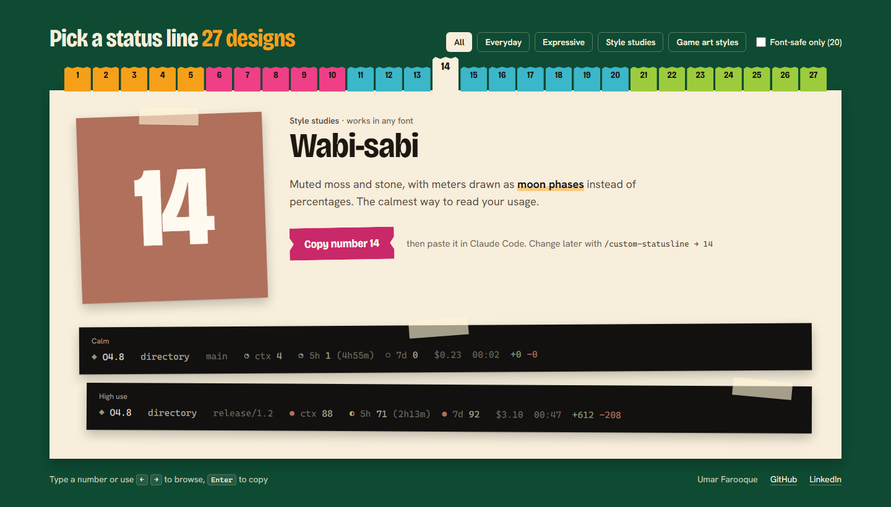

<h1 align="center">custom-statusline</h1>

<p align="center">
  <b>27 ready-made status line designs for Claude Code.</b><br>
  Open the gallery, reply with a number, and your status line is live at the next prompt.
</p>

<p align="center">
  <a href="https://github.com/umarfarooque88/custom-statusline/actions/workflows/ci.yml"></a>
  <a href="https://github.com/umarfarooque88/custom-statusline/releases/latest"></a>
  <a href="LICENSE"></a>
  
  
</p>

<p align="center">
  <a href="https://umarfarooque88.github.io/custom-statusline/"><b>Browse all 27 designs online →</b></a>
</p>

<p align="center">
  <a href="https://umarfarooque88.github.io/custom-statusline/"></a>
</p>

---

## Why

Claude Code can show a status line under your prompt: model, folder, git branch, context used, your 5-hour and 7-day limits, cost, time and lines changed. Writing one yourself means a shell script, JSON parsing, ANSI colours and a `settings.json` edit.

**custom-statusline** gives you 27 finished designs, from quiet daily drivers to full game-art HUDs. You pick one by number in a visual gallery and the skill installs it for you. Every design shows the same data; you only choose the look.

- **One command.** `/custom-statusline` installs a design and changes it later.
- **What you see is what you get.** Every gallery preview is generated from the engine's real terminal output, never drawn by hand.
- **Safe with your settings.** It merges into `settings.json` and never overwrites your other keys.
- **Cross-platform.** Windows (Git Bash), macOS and Linux. No `jq` needed.
- **Font-friendly.** 20 of the 27 designs work in any font. The rest need a Powerline/Nerd Font, and `STATUSLINE_PLAIN=1` swaps in plain glyphs.

## Quick start

**1. Install the skill.** In Claude Code, say:

```
clone https://github.com/umarfarooque88/custom-statusline
```

Claude puts the skill in `~/.claude/skills/custom-statusline` and checks that Node.js is available.

**2. Pick a design.**

```
/custom-statusline
```

The gallery opens in your browser. Use the number tabs (or type a number, or the arrow keys) to browse, then reply in Claude Code with the number you like. The status line appears at your next prompt, with no restart.

> If `/custom-statusline` isn't recognised right after installing, run `/reload-skills` or restart Claude Code once.

**Change your mind later** by running `/custom-statusline` again. Same gallery, same steps.

## A few of the designs

Each card shows a design in two states: **calm** (a fresh session) and **high use** (context and limits running hot), so you can see how it warns you.

<table>
  <tr>
    <td></td>
    <td></td>
  </tr>
  <tr>
    <td align="center"><b>9 · Synthwave</b></td>
    <td align="center"><b>12 · Bauhaus</b></td>
  </tr>
  <tr>
    <td></td>
    <td></td>
  </tr>
  <tr>
    <td align="center"><b>19 · Dracula</b></td>
    <td align="center"><b>24 · Pixel</b></td>
  </tr>
  <tr>
    <td></td>
    <td></td>
  </tr>
  <tr>
    <td align="center"><b>25 · Cartoon</b></td>
    <td align="center"><b>14 · Wabi-sabi</b></td>
  </tr>
</table>

## All 27 designs

| Everyday | Expressive | Style studies | Game art styles |
|---|---|---|---|
| 1 · Kiln Flow ⁿᶠ | 6 · Claymorphic ⁿᶠ | 11 · Brutalist | 21 · Flat |
| 2 · Nightshade ⁿᶠ | 7 · Arcade HUD ᵉ | 12 · Bauhaus | 22 · Vector ⁿᶠ |
| 3 · Hairline | 8 · Gradient Sweep | 13 · Swiss | 23 · Geometric Art |
| 4 · Gauge | 9 · Synthwave | 14 · Wabi-sabi | 24 · Pixel |
| 5 · Blocks | 10 · Phosphor LCD | 15 · Glassmorphic ⁿᶠ | 25 · Cartoon ⁿᶠ |
| | | 16 · Memphis | 26 · Cel Shading |
| | | 17 · Art Deco | 27 · Monochromatic |
| | | 18 · Nord | |
| | | 19 · Dracula | |
| | | 20 · Terminal Rain | |

ⁿᶠ needs a Powerline/Nerd Font (Windows Terminal's default Cascadia Mono works) · ᵉ needs emoji · everything else works in any font.

## What the status line shows

Every design shows the full set. A segment hides on its own when its data isn't available.

| Segment | Example | Notes |
|---|---|---|
| Model | `◆ O4.8` | Short name (Opus 4.8 → O4.8) |
| Directory | `my-project` | Current folder |
| Git branch | `▸ main` | Only inside a git repo |
| Context used | `ctx 37%` | Changes colour as it fills |
| 5-hour limit | `5h 42% (2h13m)` | Usage, plus time until the window resets · Pro/Max |
| 7-day limit | `7d 18%` | Weekly usage · Pro/Max |
| Session cost | `$0.84` | Claude Code's own API-equivalent estimate |
| Active time | `00:09` | Hours:minutes |
| Lines changed | `+58 -9` | Added / removed this session |

The `(2h13m)` countdown appears once Claude Code reports a reset time (Pro/Max, after the first response).

## Requirements

- **Claude Code**
- **Node.js** on your `PATH`. The engine uses it to parse the status line JSON.
- **git** for the branch segment (optional).
- **Bash.** On Windows, Git Bash, which ships with Git for Windows.
- A **Powerline/Nerd Font** only for the designs marked ⁿᶠ.

## Configuration

| Setting | What it does |
|---|---|
| `DESIGN=` line in `~/.claude/statusline-command.sh` | The installed design, 1–27. `/custom-statusline` sets it for you. |
| `STATUSLINE_DESIGN=N` (environment) | Overrides the design without editing the file. Handy for trying one out. |
| `STATUSLINE_PLAIN=1` (environment) | Swaps Powerline glyphs for plain blocks and keeps the colours. Use it if you see boxes. |

## Manual install

If you'd rather not ask Claude:

```bash
mkdir -p ~/.claude/skills
git clone https://github.com/umarfarooque88/custom-statusline ~/.claude/skills/custom-statusline
cp ~/.claude/skills/custom-statusline/statusline.sh ~/.claude/statusline-command.sh
# then edit the DESIGN= line near the top of ~/.claude/statusline-command.sh (1–27)
```

Add this to `~/.claude/settings.json` (create the file as `{}` first if it doesn't exist):

```json
"statusLine": { "type": "command", "command": "bash ~/.claude/statusline-command.sh" }
```

**Update** with `git -C ~/.claude/skills/custom-statusline pull`, then run `/custom-statusline` again.
**Uninstall** by removing the `statusLine` key from `settings.json` and deleting `~/.claude/skills/custom-statusline` and `~/.claude/statusline-command.sh`.

## Troubleshooting

| Problem | Fix |
|---|---|
| `/custom-statusline` isn't recognised | Run `/reload-skills` or restart Claude Code. |
| Boxes or question marks in the status line | Pick a font-safe design, install a Nerd Font, or set `STATUSLINE_PLAIN=1`. |
| Status line is empty | Check that `node --version` works in the same shell Claude Code uses. |
| `\r: command not found` on Windows | The script got CRLF line endings. Re-clone; the repo forces LF via `.gitattributes`. |
| No 5h / 7d meters | They appear on Pro/Max plans after the first response in a session. |

## How it works

One script, [`statusline.sh`](statusline.sh), contains all 27 designs. Installing copies it to `~/.claude/statusline-command.sh`, sets the design number, and adds the `statusLine` key to your settings. Claude Code then runs it before each prompt and pipes the session JSON to it. The engine parses that JSON with Node, reads the git branch without spawning a shell, and prints one line of ANSI colour.

The [gallery](gallery.html) is a single offline HTML file. Its previews are produced by [`tools/build-gallery.js`](tools/build-gallery.js): it runs the real engine against two sample sessions and converts the output to HTML, so the gallery can't drift from what your terminal shows. CI checks this on every push.

## Repository layout

| Path | Purpose |
|---|---|
| [`SKILL.md`](SKILL.md) | The skill Claude follows when you run `/custom-statusline` |
| [`statusline.sh`](statusline.sh) | The engine: all 27 designs in one script |
| [`gallery.html`](gallery.html) | The visual picker, opened locally or [online](https://umarfarooque88.github.io/custom-statusline/) |
| [`tools/`](tools) | `build-gallery.js` regenerates the previews; `ansi2html.js` turns terminal output into HTML |
| [`CLAUDE.md`](CLAUDE.md) | Setup steps Claude follows when you say "clone this repo" |
| [`PRODUCT.md`](PRODUCT.md) | Product context used when redesigning the gallery |

## Contributing

Ideas for new designs, bug reports and fixes are welcome. See [CONTRIBUTING.md](CONTRIBUTING.md) for how to work on the engine and regenerate the gallery, and [CHANGELOG.md](CHANGELOG.md) for what changed between versions.

## License

[MIT](LICENSE) © Umar Farooque

---

<p align="center"><sub>Made by <a href="https://github.com/umarfarooque88">Umar Farooque</a> · <a href="https://www.linkedin.com/in/umar-farooque88/">LinkedIn</a> · a skill for <a href="https://www.claude.com/product/claude-code">Claude Code</a></sub></p>
